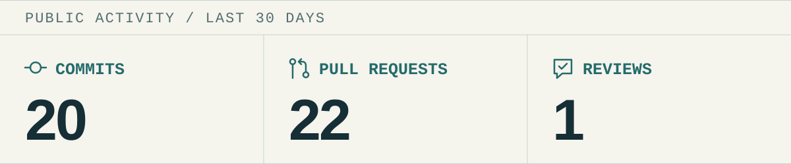

<picture>
  <source media="(prefers-reduced-motion: reduce) and (prefers-color-scheme: dark)" srcset="assets/hero-static-dark.svg">
  <source media="(prefers-reduced-motion: reduce)" srcset="assets/hero-static-light.svg">
  <source media="(prefers-color-scheme: dark)" srcset="assets/hero-dark.svg">
  
</picture>

Software engineer with a love for **mathematics, GPUs, and optimization.**

Mathematics · GPU Computing · Optimization · Quantum Computing

### Activity

<!-- ACTIVITY:START -->
<picture>
  <source media="(max-width: 600px) and (prefers-color-scheme: dark)" srcset="assets/activity-mobile-dark.svg">
  <source media="(max-width: 600px)" srcset="assets/activity-mobile-light.svg">
  <source media="(prefers-color-scheme: dark)" srcset="assets/activity-dark.svg">
  
</picture>

**Recent activity**

- `Nov 20` **Pushed** [fix\(contrib\): align F0G1 preparation channels before final readout](https://github.com/msk-ono/qubex/commit/9f94f6b8471c3670598cad09c9c703ef75ed21ab) — msk\-ono/qubex · calibrate\-f0g1\-pulse
- `Nov 20` **Pushed** [feat\(quel3\): support quelware\-client 0\.8 and server\-side session acquisition \(\#474\)](https://github.com/msk-ono/qubex/commit/ba670aadf49b3dd8f644d2db0201d76c7de7c380) — msk\-ono/qubex · develop
- `Nov 20` **Merged** [feat\(quel3\): support quelware\-client 0\.8 and server\-side session acquisition](https://github.com/amachino/qubex/pull/474) — amachino/qubex · \#474
- `Nov 20` **Opened** [feat\(quel3\): support quelware\-client 0\.8 and server\-side session acquisition](https://github.com/amachino/qubex/pull/474) — amachino/qubex · \#474
- `Nov 20` **Pushed** [Feature/cr dissipation \(\#426\)](https://github.com/amachino/qubex/commit/7fa683b708370bcbd6d90f47fa559e2b9141e5d5) — amachino/qubex · develop

Public activity · Last 30 days · Updated 2026-11-28 07:59 UTC

[About these counts](https://docs.github.com/en/account-and-profile/reference/profile-contributions-reference)
<!-- ACTIVITY:END -->
