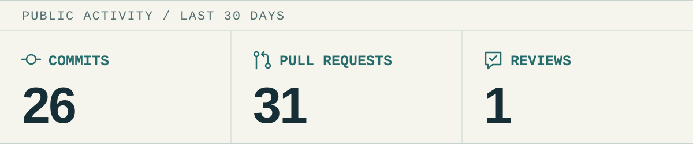

<picture>
  <source media="(prefers-reduced-motion: reduce) and (prefers-color-scheme: dark)" srcset="assets/hero-static-dark.svg">
  <source media="(prefers-reduced-motion: reduce)" srcset="assets/hero-static-light.svg">
  <source media="(prefers-color-scheme: dark)" srcset="assets/hero-dark.svg">
  
</picture>

Software engineer with a love for **mathematics, GPUs, and optimization.**

Mathematics · GPU Computing · Optimization · Quantum Computing

### Activity

<!-- ACTIVITY:START -->
<picture>
  <source media="(max-width: 600px) and (prefers-color-scheme: dark)" srcset="assets/activity-mobile-dark.svg">
  <source media="(max-width: 600px)" srcset="assets/activity-mobile-light.svg">
  <source media="(prefers-color-scheme: dark)" srcset="assets/activity-dark.svg">
  
</picture>

**Recent activity**

- `Oct 24` **Pushed** [ci: use a fixed Python 3\.11 through 3\.14 matrix](https://github.com/msk-ono/qubex/commit/b4536e3f8cc845f64ffcb4168d64836852b424e4) — msk\-ono/qubex · chore/python\-311\-support
- `Oct 24` **Opened** [chore: require Python 3\.11 and test through 3\.14](https://github.com/amachino/qubex/pull/447) — amachino/qubex · \#447
- `Oct 24` **Pushed** [test: support pytest without optional backend dependencies \(\#408\)](https://github.com/amachino/qubex/commit/35a0a236fd743d815782257d49a6966c44caad10) — amachino/qubex · develop
- `Oct 24` **Merged** [test: support pytest without optional backend dependencies](https://github.com/amachino/qubex/pull/408) — amachino/qubex · \#408
- `Oct 24` **Pushed** [test: simplify optional backend dependency setup](https://github.com/amachino/qubex/commit/2b6137a44ddd7ec8e174caf5f5590b5bcb811fea) — amachino/qubex · test/optional\-backend\-dependencies

Public activity · Last 30 days · Updated 2026-10-25 04:52 UTC

[About these counts](https://docs.github.com/en/account-and-profile/reference/profile-contributions-reference)
<!-- ACTIVITY:END -->
