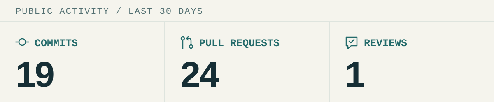

<picture>
  <source media="(prefers-reduced-motion: reduce) and (prefers-color-scheme: dark)" srcset="assets/hero-static-dark.svg">
  <source media="(prefers-reduced-motion: reduce)" srcset="assets/hero-static-light.svg">
  <source media="(prefers-color-scheme: dark)" srcset="assets/hero-dark.svg">
  
</picture>

Software engineer with a love for **mathematics, GPUs, and optimization.**

Mathematics · GPU Computing · Optimization · Quantum Computing

### Activity

<!-- ACTIVITY:START -->
<picture>
  <source media="(max-width: 600px) and (prefers-color-scheme: dark)" srcset="assets/activity-mobile-dark.svg">
  <source media="(max-width: 600px)" srcset="assets/activity-mobile-light.svg">
  <source media="(prefers-color-scheme: dark)" srcset="assets/activity-dark.svg">
  
</picture>

**Recent activity**

- `Nov 09` **Pushed** [feat\(quel3\): use fixed frequency sweep widths](https://github.com/msk-ono/qubex/commit/8856da8b77b3f684bb129c9a6bfaedd4d50e84af) — msk\-ono/qubex · feature/backend\-frequency\-sweeps
- `Nov 09` **Pushed** [docs\(release\): describe scoped frequency configuration APIs](https://github.com/msk-ono/qubex/commit/88af5183cda1a076e0a51fdaba4e2cc214d3ead2) — msk\-ono/qubex · feature/backend\-frequency\-sweeps
- `Nov 09` **Pushed** [docs\(release\): describe scoped frequency configuration APIs](https://github.com/msk-ono/qubex/commit/e6dfcd11e12316e99ee2142fcccc2f6e821c01a3) — msk\-ono/qubex · feature/backend\-frequency\-sweeps
- `Nov 09` **Reviewed** [fix: align QuEL\-1 captures and route delay by explicit placement](https://github.com/amachino/qubex/pull/414#pullrequestreview-5731980591) — amachino/qubex · \#414
- `Nov 09` **Pushed** [feat: support multi\-waveform paired interleaved randomized benchmarking \(\#461\)](https://github.com/amachino/qubex/commit/4f8200c38283870a81f166885ba3eaad1edbbb15) — amachino/qubex · develop

Public activity · Last 30 days · Updated 2026-11-10 07:27 UTC

[About these counts](https://docs.github.com/en/account-and-profile/reference/profile-contributions-reference)
<!-- ACTIVITY:END -->
